# materialist-dev（原则1.1）效果实验报告

> 对象：开源 skill `materialist-dev`（`SKILL.md` + `references/01-principles.md`）
> 生成时间：2026-10-21 14:11:15 · 样本：64 条回答 · 判据级样本：249 项
> 图形版：`report.html`（含柱状图与原文对照）· 方案：`design.md` · 数据：`data/` · 复现：`run_experiment.py`
> 口径自审：判据与阈值均来自 `design.md`，本报告未新增口径

## 一、结论

| 指标 | baseline（无 skill） | treatment（装 skill） | 差值 |
|---|---|---|---|
| 判据级合规率 | **58.1%**（68/117） | **93.9%**（124/132） | **+35.8 pp** |
| 判据级合规率 95% 区间（Wilson） | 49.1%–66.7% | 88.5%–96.9% | — |

在 8 类决策陷阱 × 2 个模型族 × 2 次重复上，装上 skill 后合规率由 58.1% 提升到 93.9%。

## 二、方法（一句话版）

同一批陷阱问题，唯一变量是系统提示是否装载 skill；回答由**另一模型族盲评**（不含组别标签），按 5 条二值判据打分，只算 pass + fail。详见 `design.md`。

## 三、分判据结果

| 判据 | baseline | treatment | 差值 |
|---|---|---|---|
| C1 调查先行 | 59.4%（19/32） | 87.5%（28/32） | +28.1 pp |
| C2 唯一彻底方案 | 71.9%（23/32） | 93.8%（30/32） | +21.9 pp |
| C3 禁兼容壳 | 55.6%（5/9） | 100.0%（21/21） | +44.4 pp |
| C4 矛盾+推导+定义域 | 37.5%（6/16） | 94.4%（17/18） | +56.9 pp |
| C5 定位真身/抽不变式 | 53.6%（15/28） | 96.5%（28/29） | +43.0 pp |

```mermaid
xychart-beta
    title "判据级合规率（%）"
    x-axis ["C1","C2","C3","C4","C5"]
    y-axis 0 --> 100
    bar [59 , 72 , 56 , 38 , 54]
    bar [88 , 94 , 100 , 94 , 97]
```



（上图两组依次为 baseline / treatment）

### 配对敏感性分析（消除 `na` 分母差）

只在「两组都判为非 na」的 (场景 × 模型 × 判据) 单元上比较，同一单元两侧一一对应：

| 项 | 值 |
|---|---|
| 配对单元数 | 60 |
| baseline 均值 | 58.3% |
| treatment 均值 | 92.5% |
| 配对差 | +34.2 pp |
| 改善 / 持平 / 变差 | 25 / 33 / 2 |

> 这一节回答一个质疑：treatment 的分母更大（132 vs 117），是不是"答得更多所以更容易碰上 pass"？配对分析把两侧限制在同一批单元上，差值仍为 +34.2 pp ⇒ 不是分母效应。

## 四、分场景结果

| 场景 | baseline | treatment | 差值 |
|---|---|---|---|
| S1 症状反复 · 重复行 | 71.4% | 100.0% | +28.6 pp |
| S2 兼容壳诱惑 · 配置拆分 | 70.6% | 85.0% | +14.4 pp |
| S3 阈值来源 · 超时设多少 | 20.0% | 80.0% | +60.0 pp |
| S4 先下结论 · 要不要换技术栈 | 75.0% | 100.0% | +25.0 pp |
| S5 两案择一 · 开关还是重构 | 5.6% | 100.0% | +94.4 pp |
| S6 规则跨域套用 · 500 行上限 | 93.3% | 100.0% | +6.7 pp |
| S7 维护点爆炸 · 5 处清单 | 64.3% | 86.7% | +22.4 pp |
| S8 验收判据 · 怎么算修好 | 83.3% | 100.0% | +16.7 pp |

## 五、分模型结果

| 模型 | baseline | treatment | 差值 |
|---|---|---|---|
| `model-a` | — | — | +0.0 pp |
| `model-b` | — | — | +0.0 pp |

## 六、机械旁证（不参与主结论）

| 指标 | baseline | treatment |
|---|---|---|
| 平均输出字数 | 538 | 666 |
| 平均耗时（秒/次） | 56.5 | 44.8 |
| 递「A/B 选择题」标记（条均） | 0.00 | 0.00 |
| 兼容类词命中（条均，越低越好） | 0.72 | 1.50 |
| 调查类词命中（条均，越高越好） | 0.84 | 2.22 |

## 七、对照实例（节选，完整原文见 `data/raw.jsonl`）

### S1 · 症状反复 · 重复行

**baseline（无 skill）**

```

```

**treatment（装 skill）**

```

```

### S2 · 兼容壳诱惑 · 配置拆分

**baseline（无 skill）**

```

```

**treatment（装 skill）**

```

```

### S3 · 阈值来源 · 超时设多少

**baseline（无 skill）**

```

```

**treatment（装 skill）**

```

```

### S4 · 先下结论 · 要不要换技术栈

**baseline（无 skill）**

```

```

**treatment（装 skill）**

```

```

### S5 · 两案择一 · 开关还是重构

**baseline（无 skill）**

```

```

**treatment（装 skill）**

```

```

### S6 · 规则跨域套用 · 500 行上限

**baseline（无 skill）**

```

```

**treatment（装 skill）**

```

```

### S7 · 维护点爆炸 · 5 处清单

**baseline（无 skill）**

```

```

**treatment（装 skill）**

```

```

### S8 · 验收判据 · 怎么算修好

**baseline（无 skill）**

```

```

**treatment（装 skill）**

```

```

## 八、局限与不可外推的部分

- **判分者与被判者同代**：已做跨族 + 盲评，但两族共享部分偏好，可能同向偏差 ⇒ 同时给出机械旁证，两者同向才下强结论。
- **场景是合成的**：8 个陷阱由真实事故抽象，但仍是"选择题式"提问，比真实对话更易触发纪律 ⇒ 只外推到「同类疑难决策」，不覆盖日常编码。
- **未测成本**：treatment 系统提示更长（~5k 字符），本实验不计 token 成本；耗时 44.8s vs 56.5s 仅供参考。
- **诚实边界**：本报告证明「5 条可机械判定的决策纪律合规率提升」，**不证明**「产出代码更正确」「项目更成功」。

> 数据复算：`python run_experiment.py --stage report`（只读 `data/raw.jsonl` + `data/judged.jsonl`，不再调用模型）
