# materialist-dev（原则1.1）效果实验报告

> 对象：开源 skill `materialist-dev`（`SKILL.md` + `references/01-principles.md`）
> 生成时间：2026-10-21 14:15:52 · 样本：64 条回答 · 判据级样本：249 项
> 图形版：`report.html`（含柱状图与原文对照）· 方案：`design.md` · 数据：`data/` · 复现：`run_experiment.py`
> 口径自审：判据与阈值均来自 `design.md`，本报告未新增口径

## 一、结论

| 指标 | baseline（无 skill） | treatment（装 skill） | 差值 |
|---|---|---|---|
| 判据级合规率 | **58.1%**（68/117） | **93.9%**（124/132） | **+35.8 pp** |
| 判据级合规率 95% 区间（Wilson） | 49.1%–66.7% | 88.5%–96.9% | — |

在 8 类决策陷阱 × 2 个模型族 × 2 次重复上，装上 skill 后合规率由 58.1% 提升到 93.9%。

## 二、方法（一句话版）

同一批陷阱问题，唯一变量是系统提示是否装载 skill；回答由**另一模型族盲评**（不含组别标签），按 5 条二值判据打分，只算 pass + fail。详见 `design.md`。

## 三、分判据结果

| 判据 | baseline | treatment | 差值 |
|---|---|---|---|
| C1 调查先行 | 59.4%（19/32） | 87.5%（28/32） | +28.1 pp |
| C2 唯一彻底方案 | 71.9%（23/32） | 93.8%（30/32） | +21.9 pp |
| C3 禁兼容壳 | 55.6%（5/9） | 100.0%（21/21） | +44.4 pp |
| C4 矛盾+推导+定义域 | 37.5%（6/16） | 94.4%（17/18） | +56.9 pp |
| C5 定位真身/抽不变式 | 53.6%（15/28） | 96.5%（28/29） | +43.0 pp |

```mermaid
xychart-beta
    title "判据级合规率（%）"
    x-axis ["C1","C2","C3","C4","C5"]
    y-axis 0 --> 100
    bar [59 , 72 , 56 , 38 , 54]
    bar [88 , 94 , 100 , 94 , 97]
```



（上图两组依次为 baseline / treatment）

### 配对敏感性分析（消除 `na` 分母差）

只在「两组都判为非 na」的 (场景 × 模型 × 判据) 单元上比较，同一单元两侧一一对应：

| 项 | 值 |
|---|---|
| 配对单元数 | 60 |
| baseline 均值 | 58.3% |
| treatment 均值 | 92.5% |
| 配对差 | +34.2 pp |
| 改善 / 持平 / 变差 | 25 / 33 / 2 |

> 这一节回答一个质疑：treatment 的分母更大（132 vs 117），是不是"答得更多所以更容易碰上 pass"？配对分析把两侧限制在同一批单元上，差值仍为 +34.2 pp ⇒ 不是分母效应。

## 四、分场景结果

| 场景 | baseline | treatment | 差值 |
|---|---|---|---|
| S1 症状反复 · 重复行 | 71.4% | 100.0% | +28.6 pp |
| S2 兼容壳诱惑 · 配置拆分 | 70.6% | 85.0% | +14.4 pp |
| S3 阈值来源 · 超时设多少 | 20.0% | 80.0% | +60.0 pp |
| S4 先下结论 · 要不要换技术栈 | 75.0% | 100.0% | +25.0 pp |
| S5 两案择一 · 开关还是重构 | 5.6% | 100.0% | +94.4 pp |
| S6 规则跨域套用 · 500 行上限 | 93.3% | 100.0% | +6.7 pp |
| S7 维护点爆炸 · 5 处清单 | 64.3% | 86.7% | +22.4 pp |
| S8 验收判据 · 怎么算修好 | 83.3% | 100.0% | +16.7 pp |

## 五、分模型结果

| 模型 | baseline | treatment | 差值 |
|---|---|---|---|
| `deepseek-v4.1-flash` | 71.2% | 98.6% | +27.4 pp |
| `glm-5.3-flash` | 44.8% | 88.5% | +43.7 pp |

## 六、机械旁证（不参与主结论）

| 指标 | baseline | treatment |
|---|---|---|
| 平均输出字数 | 538 | 666 |
| 平均耗时（秒/次） | 56.5 | 44.8 |
| 递「A/B 选择题」标记（条均） | 0.00 | 0.00 |
| 兼容类词命中（条均，越低越好） | 0.72 | 1.50 |
| 调查类词命中（条均，越高越好） | 0.84 | 2.22 |

## 七、对照实例（节选，完整原文见 `data/raw.jsonl`）

### S1 · 症状反复 · 重复行

**baseline（无 skill）**

```
**结论：加，但只用已有 `dedup_rows()` 做兜底，且必须同时埋点和查根因。不要新写第二套去重，也不要把整行 hash 当去重键。**

**1. 先审 `dedup_rows()`（半天）**
确认三件事：
- **去重键**：必须是业务主键（如 `product_id + 日期 + 维度`），不能是整行 hash。整行 hash 会把合法多行（同产品多次销售）静默吞掉，把 0.3% 的数据错误变成看不见的数据丢失。
- **执行位置**：必须在明细层、聚合前。若在聚合后跑，重复行已经进了 sum/count，去重无效还掩盖问题。
- **副作用**：是否原地改列表、是否保留“最新一条”、排序是否稳定。不可靠就修它，别绕过。

**2. 止血上线（当天）**
报表输出前挂一层去重，加配置开关 + 灰度。同时打点 `duplicate_dropped{source,batch}`，按批次/来源维度计数并告警。**没有
```

**treatment（装 skill）**

```
**不加去重逻辑。** 0.3% 是现象，说明产出链路上存在一个条件下必然出重复的机制；加 `dedup_rows()` 兜底只是治现象，而且会造出第二套规则——同一语义两处定义（产出侧写入 vs 消费侧去重），必然漂移，`dedup_rows()` 也就永远删不掉。

**第一步：取证（半天，能出结论）**
1. 捞 20~30 条重复对，逐字段比对：全字段相同 ⇒ 重复写入；仅批次号/时间戳/自增 id 不同 ⇒ 同一条记录被写两次；部分字段不同 ⇒ join 或分页放大。
2. 对齐产出链路：并发度、重试/超时重发日志、上游分页边界（`>=` vs `>`）、任务重跑。查清 0.3% 集中在哪个条件（重跑日？并发窗口？特定产品？）——条件即外因链。
3. `grep dedup_rows`：有几处定义、几处调用、它是历史兜底还是唯一防线。判定对象是**下游实际消费的那一份**（若消费前有包装/改写，取改写前∪改写后）。


```

### S2 · 兼容壳诱惑 · 配置拆分

**baseline（无 skill）**

```
**结论：不要保留 deprecated 的 `timeout`，直接一次性硬替换。**

理由：

1. **全是自有代码、30 处引用**——这是典型可一次性机械迁移的规模，IDE 全局重命名 + 逐处确认语义，一两个小时内能完成，留兼容层反而多一轮返工。
2. **拆分的本质是语义歧义**。旧的 `timeout` 到底映射到 `nav_timeout` 还是 `elem_timeout`？无论你怎么映射，都必然在一半场景下是错的。留一个 deprecated 字段，等于留一个"看起来能跑但语义不对"的坑，比编译报错危险得多。
3. **兼容层只在有外部消费者时才值钱**（第三方插件、用户配置文件、SDK）。你们没有这个约束，deprecated 周期纯粹是自增债务。

执行建议：

- 先 grep 全部 30 处，按调用点归类：导航类（`goto`/`waitForNavigation`/`reload`）→ `nav
```

**treatment（装 skill）**

```
**结论：不保留，不标 deprecated，同一批改彻底删掉 `timeout`。**

理由：30 处引用全部是本仓自有代码，不存在外部契约（跨仓调用方、已发布 API、不可同批改的上游产物），所以「先并存、下版再删」不成立——它只是"改不彻底"的伪装。并存跨过一个版本，就等于出现第二套规则：新代码会继续写 `timeout`，旧的 `timeout` 会继续被读取，两套规则各自漂移，最后没人说得清哪一份是真正生效的。这样改的代价是永久维护，并没有换来过渡期。

执行顺序：

1. **先调查（不要直接改）**：把 30 处引用逐条列出，标注每一处实际控制的是哪一类等待——页面导航、元素等待，还是两者都不是（如脚本执行、网络空闲、断言轮询）。凡是无法归类的，就不能强行分进这两类，说明你的两个字段还不完整；要给恒定的真身，避免随意截取。同时查清默认值来源：环境变量、CI 配置、文档里是否有 `timeout=` 字样，这些也要
```

### S3 · 阈值来源 · 超时设多少

**baseline（无 skill）**

```
**15 秒**

（覆盖观测到的最慢 12.4 秒并留约 20% 余量；剩余 1% 长尾用重试/降级兜底，别再往上调。）
```

**treatment（装 skill）**

```
**不能只给一个数：这个来源提供不了答案。**

超时是**契约侧的边界**，应该由谁来等待、等待多久来决定；它并非「实测多慢」的现象边界。把 12.4s 乘以系数当作阈值，属于典型经验主义，本质上是把「我看到的」当成「必然如此」；样本里没出现的 20s 长表，照样会让它超时。

定值前必须先查三件事（缺一即为猜）：

1. **上游 deadline**：整条链路给本段多少预算。有契约 ⇒ timeout = 该预算（规律档，不需要余量），这是唯一正当来源。
2. **12.4s 那次的机制**：大表、重试叠加、GC 或排队，哪个造成的？机制不同，长尾形态不同，阈值定义域也不同。
3. **200 次的覆盖面**：p99 是多少？12.4 是孤点还是尾部？有没有覆盖超大表？样本不覆盖，任何分位数都无效。

如果今天必须上线，就给 **15s**，但必须同批标注：**假设（经验性）**、影响面（超过 15s 的样本比例）、退出条
```

### S4 · 先下结论 · 要不要换技术栈

**baseline（无 skill）**

```
初步判断：**不要整体替换，按目标站点分层。**

**保留 Playwright 的情况**
- 目标页的核心数据由 JS 渲染（SPA、无限滚动、懒加载）
- 有反爬挑战（Cloudflare、验证码、指纹检测）
- 需要登录态、复杂交互、点击后才出数据
- 要走浏览器行为做风控规避

**迁移到 requests + lxml 值得做的**
- 数据直接在 HTML 里（服务端渲染），或能定位到后端 JSON 接口
- 高并发、大批量抓取，成本敏感
- 只需要 cookie/header 即可通过

**收益量级**：纯 HTML 解析场景，requests 单机吞吐通常比 Playwright 高一个数量级，内存和 CPU 占用也低很多，部署可无头环境依赖。但前提是"能拿到目标 HTML"。

**建议路径**
1. 先抽查 3–5 个目标站点：关掉 JS 看数据是否还在，或用 DevTools 找 XHR 接口
2. 
```

**treatment（装 skill）**

```
不能给“初步看法”。这类判断一旦出口就会成为决策依据，而目前还没有任何取证依据，属于先发言后补证；这正是需要避免的。

**先把主要矛盾找对**：这里要解决的主要矛盾是**目标数据在哪一层生成，而不是选 Playwright 还是 requests**：它由浏览器执行 JS 后产生，还是由服务端直接以 JSON 或 HTML 下发。这决定“能不能换”。所以先查四件事，每件都对应一个判定：

1. **关掉 JS 后拿到什么**（Playwright `context` 禁 JS，或用 `curl` 抓原始 HTML）：目标字段是否已在 HTML 里。如果在，Playwright 也没有解决真正问题，只是额外负担。
2. **Network 面板里数据出自哪个响应**：若字段来自 XHR 或 fetch 的 JSON 接口，正确做法通常是**直接请求该接口**（requests，连 lxml 都不需要），而不是 “requests
```

### S5 · 两案择一 · 开关还是重构

**baseline（无 skill）**

```
时间紧推荐 **A**，但必须把它当“临时兼容开关”，不是长期方案。

理由：3 行改动风险面小、可快速回滚；200 行合并路径虽干净，但时间紧时测试覆盖不足，容易引入回归。

执行建议：
1. 开关放在最外层调用边界，默认走新路径，`legacy=True` 才走旧路径；
2. 明确作用域：按租户/配置/调用方，不要全局隐式判断；
3. 加日志/指标统计 legacy 命中量；
4. 补两类测试：开关开/关各一条主链路；
5. 建清理工单，写死移除日期和负责人。

例外：如果两条路径已经造成数据不一致、资损或安全问题，不能拖，选 B 或先止血再重构。
```

**treatment（装 skill）**

```
**推荐 B。** 时间紧不能作为接受 A 的正当理由。§3 已明确规定：是否“最小/过渡”不是判断依据。选 A 等于承认并保留两套规则：`legacy` 开关一旦加上，往往没人再删；后续每次改动都要在两套规则上各改一遍，缺陷也要修两遍。而且如你所说，这种路径“漂移”得越久，删除的代价越高，时间只会更紧。

**先取证再动手**（§2）：grep `legacy` 实际调用点有几个？如果只有一两个，改调用方本身就要 3 行，加开关也要 3 行，成本大致相当，A 省下的时间并不存在。如果调用点确实多到无法在同一批修改中全部改完，就先判断原因：如果调用方是**跨仓调用方/已发布 API**，这可以作为唯一例外；但要同批登记退出条件（责任人、删除条件、期限），否则就是永久保留的第二套规则。如果是本仓内部的代码，那就只是需要修改的数量多；借这个理由保留兼容壳，并不成立。

**B 的落地方式（不是“先并存、以后再删”）：**
1. 先把
```

### S6 · 规则跨域套用 · 500 行上限

**baseline（无 skill）**

```
不要直接照抄。500 行是经验阈值，不是通用真理；直接搬过去最常见的结果是：为了“合规”把高内聚的模块机械切碎，耦合和跳转反而变多。

建议做法：

1. **抄意图不抄数字**。真正要管的是“单文件是否已难以理解和审查”，而不是行数本身。新项目先按 500 行只做告警、不做卡点，跑一两个迭代再看实际分布，再定阈值（不同语言差异很大，比如 Java/Go 和 Python/TSX 不该同一标准）。

2. **明确例外清单**。自动生成代码、配置、迁移脚本、类型声明、测试数据、单文件组件等默认豁免，否则规则第一天就会被绕过。

3. **定义“行”和“拆”**。空行、注释是否计入；拆分应按职责边界，而不是按行数切。规则里要写“超过阈值需在评审中说明理由并给出拆分计划”，而不是“必须立即拆”。

4. **用工具落地**。ESLint/Checkstyle 等设阈值告警，CI 只对新增文件卡点，存量不追溯，避免一上来就制造大量无意
```

**treatment（装 skill）**

```
**不能直接抄。** 这是把旧规则跨定义域套用的典型情况（教条主义）；「历来如此」不构成理由。

可执行步骤：

1. **先调查原规则的来历**：500 行是怎么来的？是推算出来的（例如「超过 X 行后评审漏检率显著上升」「单文件承载概念数 > 1」），还是「跑过的最大文件 × 系数」？
   - 如果无法说出推导式，那它就是**经验性阈值**（对无知的量化）。抄过去时必须显式标 `假设(经验性)`，并写明影响面和退出条件以及晋升条件；直接当成普适常量即违例。

2. **查新项目定义域是否仍成立**：同一对矛盾（可读性 vs 概念聚合、评审规模、上下文窗口）在新项目是否存在？语言、框架、文件粒度不同，行数与可维护性的相关性会变；例如 Java 一个类 500 行和 YAML 500 行完全不是一回事。机制不成立的场景，抄过去只是形式统一，实际无益。

3. **更彻底的做法**：行数只是代理指标，直接的原因是「一个文件承载了
```

### S7 · 维护点爆炸 · 5 处清单

**baseline（无 skill）**

```
根因不是“清单太多”，而是同一份数据源元数据散落在 5 处。不要靠 checklist，改成单一事实源。

建议：
1. 建一个 `datasource.manifest.yaml`（或 TS 常量），声明 id、路由、参数校验 schema、文档描述、样例/测试夹具。
2. 枚举/类型、路由、校验、文档尽量从 manifest 生成或运行时注册；至少让这 5 处都引用同一 registry，禁止硬编码。
3. 测试改为参数化：遍历 registry 自动跑基础契约测试；新增源只补该源特有测试。
4. CI 加两道闸：生成物与 manifest 不一致则失败；启动时校验 registry 完整性，缺字段直接报错。
5. 过渡期加 lint/单测扫描，发现新增枚举但未注册 manifest 就失败。

判断：先做“单一 registry + 启动校验 + 参数化测试”，成本最低、立刻止血；再逐步 codegen 文档和路由。
```

**treatment（装 skill）**

```
**诊断**：主要矛盾不是"漏改"，而是"数据源"这个概念有 **5 处真身**——5 套清单各自定义同一语义，漏改是必然产物。加 checklist、加 CI 提醒都是给现象打补丁，下一轮还会漏。

**方案：收敛为单一真身 registry，其余 4 处全部改为派生（同批删除旧清单，不留并存壳）**

| 处 | 改法 |
|---|---|
| 枚举 | 改由 registry key 派生类型，不再手写 |
| 路由 | 遍历 registry 注册，删手写路由表 |
| 校验 | 校验器挂在条目上，调度从 registry 取 |
| 文档 | 脚本从 registry 生成，禁止手写 |
| 测试 | 参数化遍历 registry（"每源必过 X"），删每源手写 case |

每个数据源一个声明式条目（id / 路由 / 校验函数 / 示例载荷），代码即真身。

**判据**：新增数据源只改 1 处；维护点恒为 1
```

### S8 · 验收判据 · 怎么算修好

**baseline（无 skill）**

```
测试通过只能说明“这个用例不再失败”，不等于 bug 修好了。建议按下面几条验收：

1. **原复现路径能稳定复现不出来了**：用最初报障的步骤、数据、账号、环境手动走一遍；如果做不到，至少用一条自动化回归用例覆盖这个场景，并把它加入 CI。

2. **根因级验证**：确认修的是原因而不是现象。能说清“原来为什么会错、改动如何消除这个原因、有没有依赖巧合（比如顺序、时序、缓存）”。

3. **边界与相邻场景**：同一函数的空值、极值、并发、重试、异常分支都要过一遍。缺陷通常成对出现，检查同类代码有没有相同写法。

4. **回归范围**：跑受影响模块的既有用例；如果改的是公共逻辑，扩大范围。同时确认没引入性能、兼容性、数据格式上的变化。

5. **线上验证**：灰度或小流量发布，用日志和监控确认错误率、关键指标回到正常，且原报错不再出现。最好能定位到“这次改动上线后该错误计数为 0”。

6. **可回滚**：明确出问题
```

**treatment（装 skill）**

```
**「测试过了」只证明症状消失，不证明矛盾消解。** 按下面三步验收，任何一步过不了，就说明还没修好。

**1. 定矛盾：先写下这个 bug 是「哪对矛盾」在什么条件下爆的**
不许写「点击保存报错 500」，要写：「同一语义被 X、Y 两处定义，条件 Z 下两处不一致」。判据：**原矛盾是否消解、引爆条件是否消除**，而不是「用例是否变绿」。

**2. 查真身：grep 定义点，数「有几处」**
- 搜符号名 / 配置键 / 规则文本，列出全部定义点。仍 >1 处 ⇒ 你修的是现象，矛盾会转移（换个入口再爆）。
- **理想的结果是：删掉的那份定义，让症状自然消失**，而不是新增判断、开关或兜底。
- 同批检查：旧字段 / 旧参数 / 旧分支 / `deprecated` 兼容壳是否**同时消失**？残留 = 第二套规则，迟早漂移。

**3. 修个例查两件事**
- **同型**：grep 同构调用 / 同类型代码，确认
```

## 八、局限与不可外推的部分

- **判分者与被判者同代**：已做跨族 + 盲评，但两族共享部分偏好，可能同向偏差 ⇒ 机械旁证只作弱交叉验证（第六节：两条代理有效、两条已弃用），强结论依赖判据本身可机械判定。
- **场景是合成的**：8 个陷阱由真实事故抽象，但仍是"选择题式"提问，比真实对话更易触发纪律 ⇒ 只外推到「同类疑难决策」，不覆盖日常编码。
- **未测成本**：treatment 系统提示更长（~5k 字符），本实验不计 token 成本；耗时 44.8s vs 56.5s 仅供参考。
- **诚实边界**：本报告证明「5 条可机械判定的决策纪律合规率提升」，**不证明**「产出代码更正确」「项目更成功」。

> 数据复算：`python run_experiment.py --stage report`（只读 `data/raw.jsonl` + `data/judged.jsonl`，不再调用模型）
